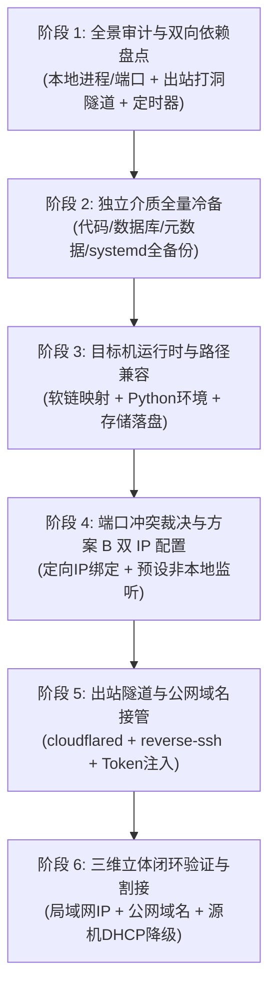

# 服务器全量无感迁移与多 IP 接管技能指南 (Server Migration Skill)

本技能提炼自多次千万级请求与关键常驻生产机（如 AMD 7840H w3、RK3588 5p、SM8250 骁龙 865）的真实全量服务搬迁、双 IP 冲突治理、出站打洞隧道与无感割接实践。

---

## 一、 核心铁律（Six Pillars）

1. **先冷备后动手**：任何改动前，必须将源机器的全量磁盘、Systemd 单元、Crontab、Docker 卷及元数据完整打包至独立 NAS 或安全存储。
2. **动静分离，按需瘦身**：区分真正需要搬迁的业务代码/数据库（通常仅十几 GB）与大体积冷媒体/日志（走 NAS 共享或独立归档），避免目标盘存储膨胀。
3. **入站与出站必须双向清点**：不仅要清查 `0.0.0.0` 局域网监听端口，**必须专项清查向外发起的打洞隧道（Cloudflare Zero Trust, Reverse SSH, FRP, WireGuard, DDNS）**。
4. **方案 B 优先（保留原 IP 零改动）**：
   - 当终端（手机、电视盒、中控屏）高度依赖原 IP 时，**强烈推荐目标机绑定辅助 IP（VIP）接管原 IP**，否决改动所有客户端配置的方案 A。
   - 端口冲突时，通过 Linux 内核 `net.ipv4.ip_nonlocal_bind=1` 实现单机同端口不同 IP 定向监听并存。
5. **双维度立体验收**：
   - 维度一：局域网内部真实 IP 直连探活（`http://192.168.x.x:port`）；
   - 维度二：外部公网域名与 Ingress 端到端探活（`https://*.domain.com`）。
   - **两维度全部通过前，严禁关机或拔线！**
6. **回写与知识固化**：迁移完成必须同步更新架构拓扑图、端口对照表与机器备忘，未回写等于未完成。

---

## 二、 六步标准化迁移 SOP



### 阶段 1：全景审计与双向依赖盘点 (Audit)

运行辅助脚本 `scripts/audit_source_host.sh` 或手动执行：
1. **监听端口盘点**：`ss -tulpn` 筛选出所有有效监听端口，记录进程名与 PID。
2. **出站长连接/隧道专项排查**（最易遗漏点）：
   ```bash
   # 必须排查 cloudflared, ssh -R, frp, wireguard, tailscale, ddns
   systemctl list-units --type=service | grep -E 'cloudflared|tunnel|frp|wg|tailscale|ddns'
   ps aux | grep -E 'cloudflared|ssh.*-R|frpc'
   ```
3. **服务管理器**：
   - 系统级：`systemctl list-units --type=service --state=running`
   - 用户级：`systemctl --user list-units --type=service --state=running`
4. **计划任务**：`crontab -l`（当前用户与 root 用户），`/etc/cron*` 目录。
5. **容器环境**：`docker ps -a --format "table {{.Names}}\t{{.Image}}\t{{.Status}}\t{{.Ports}}"`。

### 阶段 2：独立介质全量冷备 (Cold Backup)

1. 在安全存储（如 NAS）建立以日期命名的专属备份目录（如 `5p_full_backup_YYYYMMDD/`）。
2. 元数据先行导出：
   - Crontab 输出到 `crontab.txt`
   - Systemd 单元文件全量打包：`tar czf systemd_backup.tar.gz /etc/systemd/system/ ~/.config/systemd/user/`
   - 进程与网络表输出到 `meta/`
3. 业务代码与数据同步：
   - 排除掉挂载的外部网络驱动器、运行时套接字与 `/proc`、`/sys`。
   - 保留文件权限与属组（`rsync -aHAXz --numeric-ids`）。

### 阶段 3：目标机运行时与路径兼容 (Runtime & Pathing)

1. **绝对路径与用户名兼容**：
   - 若原代码存在大量硬编码路径（如 `/mnt/nvme` 或 `/home/orangepi`），目标机建立绝对软链接：
     ```bash
     sudo ln -s /data/nvme /mnt/nvme
     sudo ln -s /home/target_user /home/source_user
     ```
   - 创建兼容用户凭据并赋予免密 sudo 与 SSH 公钥，防止脚本内跨机调用报错。
2. **Python 与依赖隔离**：
   - 若目标机系统 Python 较新（如 3.12/3.14），而源程序依赖旧版二进制包（如 3.10），使用 `uv` 独立编译并安装独立 Python 运行时至 `/usr/local/bin/python3.10`。
   - 重构虚拟环境指向新解释器，测试导入 `pandas`, `numpy`, `fastapi` 等关键 C 扩展库。

### 阶段 4：端口冲突裁决与方案 B 双 IP 配置 (Scheme B Dual-IP)

当源机与目标机存在同名端口冲突时（如两机均占用了 `8146` 和 `8150`）：

1. **内核非本地绑定持久化**（允许服务在 IP 激活前或网卡漂移时监听）：
   ```bash
   echo "net.ipv4.ip_nonlocal_bind = 1" | sudo tee /etc/sysctl.d/99-ip-bind.conf
   sudo sysctl -p /etc/sysctl.d/99-ip-bind.conf
   ```
2. **服务定向 IP 监听**：
   - 目标机原生服务修改配置，从 `0.0.0.0` 改为显式绑定 `192.168.x.目标IP:port`；
   - 迁移过来的服务修改配置，显式绑定 `192.168.x.源IP:port`；
   - 启动两端服务，验证 `ss -tulpn | grep port`，确认两者在同一物理机共存。
3. **目标机挂载辅助 IP**：
   ```bash
   sudo nmcli con mod "Wired connection 1" +ipv4.addresses 192.168.x.源IP/32
   sudo nmcli con up "Wired connection 1"
   ```

### 阶段 5：出站打洞隧道与公网 Ingress 接管 (Outbound Tunnels)

1. **Cloudflare Zero Trust 远程隧道接管**：
   - 目标机安装原生 `cloudflared` 二进制包；
   - 从源机 systemd 单元提取 `--token <TOKEN>` 参数；
   - 在目标机注册开机守护：
     ```bash
     sudo cloudflared service install <TOKEN>
     # 或自建 /etc/systemd/system/cloudflared.service
     sudo systemctl enable --now cloudflared
     ```
   - 检查 `journalctl -u cloudflared` 确认与 Cloudflare 边缘节点握手成功并同步 Ingress 规则。
2. **反向 SSH 隧道接管**：
   - 复制源机的打洞私钥 `id_tunnel` 到目标机（保持对应公钥在外部 VPS 白名单中）；
   - 配置目标机的用户级 systemd 单元 `home-tunnel.service`，监听对应打洞端口；
   - 检查外部 VPS 上端口处于 LISTEN 状态。

### 阶段 6：三维立体闭环验证与割接 (Verification & Cutover)

1. **源机 DHCP 优雅降级与释放 IP**：
   - 源机停止重复业务服务并禁用自启；
   - 执行脚本将源机切为 DHCP 动态 IP，通过 NAS/其他机器中继记录新 IP，确保随时可登录救援；
2. **目标机广播免费 ARP（Gratuitous ARP）**：
   - 目标机激活源 IP 后，必须立即向局域网广播 ARP 更新，通知主路由与终端刷新 MAC 映射：
     ```bash
     sudo arping -c 5 -A -I <网卡名> 192.168.x.源IP
     sudo arping -c 5 -U -I <网卡名> 192.168.x.源IP
     ```
3. **立体端到端验证测试**：
   - 执行自动化探测脚本 `scripts/verify_endpoints.py`，遍历清单中所有 HTTP/HTTPS/API 端点；
   - 逐项测试公网域名（如 `https://*.330725.xyz`），确认 Ingress 流量正常贯通；
4. **清理与收尾关机**：
   - 确认无误后，安全执行源机 `poweroff`。

---

## 三、 避坑指南（Lessons Learned from Real Cases）

### 坑 1：Docker 挂载目录权限导致服务静默崩溃
- **现象**：MoonTV 正常运行，但其依赖的 Kvrocks 容器反复进入 `Restarting (133)` 状态。
- **真因**：Kvrocks 容器内以独立非 root 用户运行，在生成当日新日志文件（如 `kvrocks_2026-11-18.log`）时因宿主机挂载目录权限为 `755` 抛出 `Permission denied: Aborted (6)`。
- **解法**：迁移数据卷后，执行 `chmod -R 777 /data/nvme/docker/<app>/data` 彻底解除跨容器用户权限阻断。

### 坑 2：出站隧道与公网域名在关机后全线 502
- **现象**：局域网 30 个服务全绿，源机关机后所有带域名的外网服务（影视、TVBox、看板）全部瘫痪。
- **真因**：`cloudflared` 和 `ssh -R` 不在局域网开放业务端口，易被当作无用系统进程漏掉；且本地无 `config.yml` 文件，Token 直接写在 systemd 启动参数里。
- **解法**：遵循铁律第 3 条与第 5 阶段，下线源机前必须显式提取 Cloudflare Token 并在目标机部署 `cloudflared`，同时外网域名探活纳入上线前必检项。

### 坑 3：局域网 ARP 缓存导致访问延迟或间歇性丢包
- **现象**：IP 割接后，部分终端仍然试图连接旧物理机的 MAC 地址，表现为几分钟内无法连接。
- **解法**：目标机上线后立即使用 `arping` 发送无应答 ARP 广播（`-A` 与 `-U`），强制局域网交换机与客户端刷新 ARP 表项。

### 坑 4：SSH 穿透主机指纹冲突（Remote Host ID Changed）
- **现象**：外网通过反向隧道连接 `ssh 5p-remote` 时报 `REMOTE HOST IDENTIFICATION HAS CHANGED` 拦截。
- **真因**：隧道后方的机器从 5p 换成了 865，主机公钥指纹更新。
- **解法**：客户端本地执行 `ssh-keygen -R '[127.0.0.1]:12251'` 清除旧指纹并自动信任新主机公钥。
